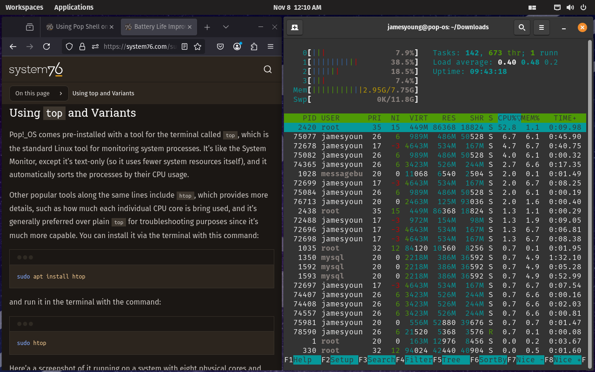
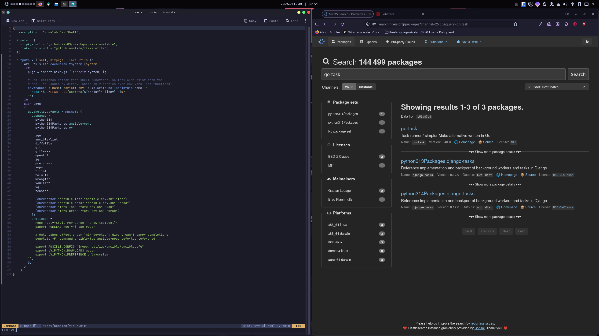

I wanted to use this post to write about my Linux distrohopping experience starting from my first experience with Linux in early-2021 to mid-2024 when I settled on NixOS.

My use case during this period was mostly web browsing and gaming with some coding/development for school and personal projects.

## Before Linux

Before Linux, I was only familiar with Windows and macOS. As a kid I mainly used my family's shared PC which ran Windows 7. When I hit my teens, I was given a 2013 Intel MacBook Pro which I used for over 6 years.

In 2020, Covid-19 hit and all my classes ended up being online. During this time, I started watching lots of Linus Tech Tips and being stuck at home I decided I wanted to get a gaming PC. So in 2021, I built my first gaming PC and after assembling the parts, I realized I needed to decide what OS to install on it.

## Switching to Linux

I had previously watched a video by Linus Tech Tips called ["Ultimate PC Building RACE!"](https://www.youtube.com/watch?v=7DhWFIrQeDA), where Emily (Anthony in the video) tried to use [Pop!_OS](https://system76.com/pop) to win the challenge.

The video was my first exposure to Linux and after doing a quick bit of research, I found that I preferred the benefits of Linux (privacy-respecting, open source, no constant update reminders) over Windows and decided to give Pop!_OS a shot.

## Pop!_OS: My First Distro

My first few months with Pop!_OS were pretty nice and generally stable. I was surprised by how much I preferred the experience of [GNOME](https://www.gnome.org/) and Pop!_OS together over macOS. For example, the tiling window manager (WM) [extension](https://github.com/pop-os/shell) Pop!_OS created for GNOME was awesome to use.

However, after a few months I swapped my motherboard to downsize to an ITX case and started seeing intermittent GPU issues where during long gaming sessions my system would randomly crash. The journal log would have some error like `ring gfx_0.0.0 timeout`. I ruled out thermal issues as my GPU temps were right below 80°C and also tried undervolting my GPU with [CoreCtrl](https://gitlab.com/corectrl/corectrl) with no luck.

I naively concluded I needed a new distro to fix this problem. In hindsight, I probably should have spent more time trying to find the actual root cause, but at the time I was frustrated and wanted to try something new.

## Manjaro: Your Website's SSL Cert Expired Again

During 2022, I heard a lot about Arch and was drawn by the popularity but scared off by its reputation of being hard to set up and maintain, so I decided to try [Manjaro](https://manjaro.org/) which was supposed to be the easier and more stable version of Arch.

My initial impression was great, where I found the [AUR](https://aur.archlinux.org/) amazing with the comprehensive package system that felt a lot better than what apt offered.

However, after a couple months of use, I was a bit worried about relying on a distro run by an organization with [recurring SSL certificate expiration on their official website](https://www.reddit.com/r/linux/s/9urWuhLMWk) and decided to leave.

_Side note: As of writing this years later in 2026, they still seem to run into this issue which to me seems absurd._

## Debian: Too Stable for Me

I decided to try [Debian](https://www.debian.org/), as people were praising about how reliable and stable their Debian systems were. My journey with Debian was very short as I found lots of my software was behind versions I wanted to use so I decided to hop to a distro with more up-to-date packages.

_Side note: These days I pretty much exclusively run Debian for all my homelab machines/VMs._

## Arch: I Used Arch BTW

Sometime 2023, I decided to finally try [Arch](https://archlinux.org/). It was a great distro for the most part, where [ArchWiki](https://wiki.archlinux.org/title/Main_page) was by far the best Linux distro wiki I've used. It was also pretty easy to transition as I used Manjaro before and brought back my beloved AUR.

The main issue with Arch that annoyed me was occasional update issues, where one time after a long vacation I went home and updated my system and afterwards it somehow borked my system. I don't know the exact error since this was years ago, but it was enough to make me reconsider a rolling distro.

## NixOS: Where I am Today

At around mid-2024, I saw a bunch of Reddit posts about [NixOS](https://nixos.org/). I was drawn by the declarative configuration part of Nix, particularly as I was starting to store my local configs in a git repository. After testing out NixOS on a secondary boot for a while, I found that I really liked the idea and decided to fully commit and switch.

As of writing this, I am still running NixOS on my personal daily-drivers and I am happy with my setup. My full journey using NixOS is in ["My NixOS Journey So Far"](/blog/my-nixos-journey) post.

## Other Distros I Briefly Ran

### Fedora: Nice

Back in uni, I bought a second-hand Surface Go that I installed Arch with [linux-surface](https://github.com/linux-surface/linux-surface). After graduating, I stopped using this device for a few years until recently in mid-2026 where I decided to wipe it and install [Fedora](https://fedoraproject.org/) on my Surface Go.

I used my Surface Go with Fedora briefly to test out Plasma Bigscreen with the idea maybe it could act as an HTPC. However after giving it a thought, this sounded like a pretty dumb idea so I threw it back into the old electronics box.

Nothing against Fedora btw; I had a pleasant experience from my short usage that day.

### Ubuntu: Boring

In my robotics course in 2023, we had to use ROS, so I used a VM with [Ubuntu](https://ubuntu.com/) to run ROS. I did try using ROS with Docker but ran into issues.

It worked fine but I fail to see why you would recommend Ubuntu over other distros like Fedora. I think it looks pretty ugly out of the gate and also not the biggest fan of Snap either.

### Linux Mint: I Guess I Like KDE More

I briefly tried [Linux Mint](https://linuxmint.com/) since it's another one of the highly recommended "it just works" distros.
I think I didn't use it long as I personally preferred [KDE](https://kde.org/plasma-desktop/) over the DEs Mint bundled with.

## What About the DE and Tiling WM?

From 2021 to 2022, I used GNOME as it was shipped with Pop!_OS so I was most familiar with it. When I switched to Arch, I moved to KDE as I dislike the lack of customization of GNOME and hated how every update seemed to break all the extensions and plugins I had.

After seeing a bunch of cool tiling WM, I decided to try [AwesomeWM](https://awesomewm.org/) with my Arch setup. During this time I realized I didn't have the energy to fully customize and maintain the AwesomeWM configs like all the cool posts I saw had so I went back to KDE which I still use with [Krohnkite](https://krohnkite.com/) for tiling.

## Reflection

It was fun to look back on my distrohopping journey but it also made me realize how stupid my justifications for changing distros were.

I'd say for the most part, the distro choice didn't really impact my day-to-day, hence why most of my experience was fine. Some distros have nicer out-of-the-box experiences but I tend to like to tweak my system afterwards anyways.

The only main difference I used to feel was the shipped package manager, although this no longer really matters to me with the ability to use Flatpaks and Nix package manager across distros.

In reality the choice of DE, tiling WM, and other software suite I picked had a much larger impact on my actual experience.
